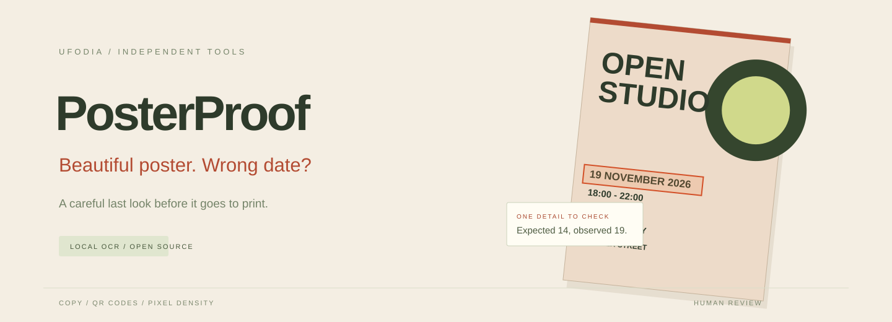
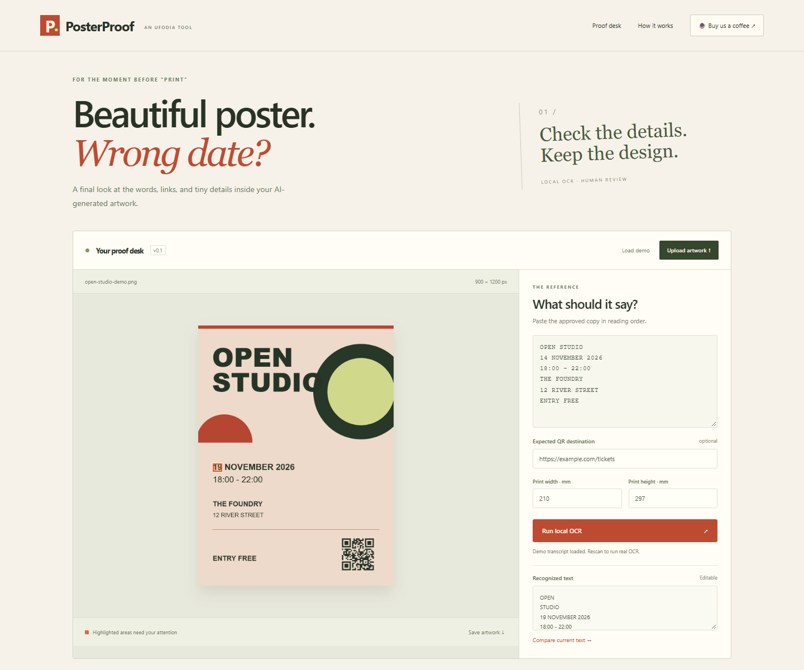

<p align="center"></p>

<p align="center"><strong>Beautiful poster. Wrong date?</strong><br>A local proof desk for the text, QR destinations, and image dimensions inside generated artwork.</p>

<p align="center"><a href="LICENSE"></a>   <a href="https://buymeacoffee.com/ufodia"></a></p>


**[Open the live app ↗](https://poster-proof.vercel.app/)** · [Deployment guide](docs/DEPLOYMENT.md)

## Catch it here. Not on 500 copies.

AI-generated artwork can look finished while a date, address, or ticket link is wrong. PosterProof compares the text recognized from your image with approved copy, points out mismatched regions, decodes a QR code, and keeps your review in a downloadable report.

You supply the reference. You inspect the evidence. The artwork stays on your device.



## Run locally

You need **Node.js 24.18 or later** and npm. No account or API key is required.

```bash
git clone https://github.com/ufodia/poster-proof.git
cd poster-proof
npm ci
npm run dev
```

Open the local URL printed by Vite. The demo poster includes an incorrect date and a QR destination that differs from the reference. Its initial transcript is an explicitly labeled fixture. Select **Run local OCR** to rescan the actual pixels with Tesseract.

The `predev` and `prebuild` scripts copy the English trained model, OCR worker, and WASM cores from installed npm packages into local assets. Installation requires internet access; OCR uses those same-origin assets afterward and does not download a model from a CDN.

## What the proof desk does

| Feature | Behavior |
| --- | --- |
| Real OCR | Tesseract.js recognizes English text from PNG/JPEG pixels in a browser worker |
| Copy comparison | Order-aware token comparison detects missing, changed, and extra words |
| Evidence overlay | OCR word coordinates highlight observed mismatches and low-confidence readings |
| Editable transcript | Correct an OCR reading and compare it again; stale coordinates are not reused |
| QR check | jsQR decodes the image and compares its content exactly with your expected destination |
| Print density | Calculates effective horizontal/vertical DPI at your intended physical dimensions |
| Human review | Mark individual findings reviewed and export the text, findings, metadata, and review IDs |

**This is a review aid, not a print-readiness certificate.** OCR can misread text. Case and decorative punctuation are normalized. DPI does not measure perceived sharpness, bleed, color accuracy, or printer requirements. Read the [limitations](docs/limitations.md).

## Your first proof

1. Upload a PNG or JPEG, or keep the demo artwork.
2. Paste approved copy in reading order, one passage per line.
3. Add the expected QR destination and intended print dimensions if relevant.
4. Run local OCR. Inspect the recognized text and every highlighted region.
5. Correct OCR mistakes if necessary, compare again, and record review decisions.
6. Export the JSON proof report and perform your normal visual/print review.

Use the [complete user guide](docs/user-guide.md) for upload limits, manual transcripts, and troubleshooting.

## Privacy by construction

- Uploaded pixels, approved copy, and recognized text are processed in memory.
- The app has no backend, analytics, account system, or cloud inference.
- OCR code, WASM, and English model assets are served from your local app.
- Data is not stored in browser local storage or a database. Reloading clears it.
- An exported JSON report contains your text and the image filename, but not image bytes.

External GitHub and Buy Me a Coffee links contact those services when opened. README badges are remote images. Browser extensions and your own hosting configuration are outside the application's processing boundary.

## Build and verify

```bash
npm run typecheck
npm test
npm run build
npm run preview
```

`npm run check` runs type checking, unit tests, and a production build. Tests include text changes, repeated words, stale coordinate rejection, print-density validation, and decoding a real generated QR fixture. Browser OCR requires a modern browser with WebAssembly and workers; see [architecture](docs/architecture.md).

`dist/` contains the deployable static app and local OCR assets after a build. CI checks code only and does not deploy it. Keep the entire output together: removing `dist/ocr/` breaks local OCR.

## Explore and contribute

- [User guide](docs/user-guide.md)
- [Architecture and OCR assets](docs/architecture.md)
- [Report format](docs/formats.md)
- [Limitations](docs/limitations.md)
- [Contributing](CONTRIBUTING.md) · [Security policy](SECURITY.md) · [Changelog](CHANGELOG.md)

The in-app **Save artwork** action exports the analyzed PNG. See [examples](examples/README.md) to reproduce the demo and proof workflow. Use invented or redacted materials in public issues.

## Keep independent tools alive

If PosterProof caught a detail before it became a print run, consider supporting its maintenance.

<a href="https://buymeacoffee.com/ufodia"></a>

Bug reports with small, anonymized reproductions are welcome too.

## License and credits

[MIT](LICENSE) · Copyright © 2026 **Ufodia**.

OCR is powered by [Tesseract.js](https://github.com/naptha/tesseract.js) and its core, with the npm-distributed English language data. QR decoding uses [jsQR](https://github.com/cozmo/jsQR); the demo QR is generated with [node-qrcode](https://github.com/soldair/node-qrcode). Third-party packages retain their own licenses; see [THIRD_PARTY_NOTICES.md](THIRD_PARTY_NOTICES.md).

## Browser checks

The real workbench flow is covered by [Playwright browser tests](docs/BROWSER_TESTS.md), including local exports and mobile layout. Run `npm run test:browser` after installing Chromium.
