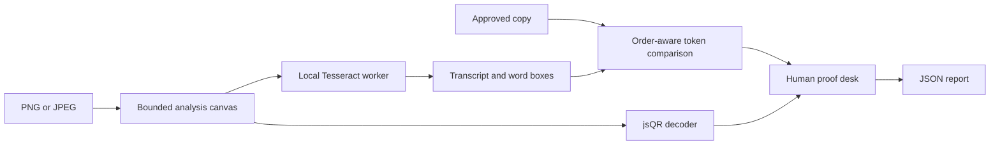

# Architecture

`src/core.ts` contains pure text comparison, QR-result classification, and print-density calculations. Token comparison uses a longest-common-subsequence alignment, preserving order and repeated occurrences. The 1,500-token limit bounds its matrix to a practical size. `src/main.ts` owns the image canvas, worker lifecycle, review state, and DOM. `src/demo.ts` creates a synthetic image and QR locally.

OCR runs in a Tesseract worker. The app requests word blocks explicitly and flattens their paragraph/line hierarchy. It maps findings back to boxes only while the transcript matches the normalized OCR word sequence. Manual edits additionally clear all OCR words and confidence observations. Inputs and comparison are disabled while a scan is pending, and the prior report is invalidated before scanning. An old report cannot be exported against a new scan or edited reference.

`scripts/vendor-ocr.mjs` copies installed worker, WASM core, and English model files to `public/ocr/` before development or building. The core is resolved from Tesseract.js's own dependency tree, so the served WASM entry points match that worker, including relaxed-SIMD variants. Those generated assets are ignored by Git and reproducible from `package-lock.json` and `npm ci`. Vite copies them into `dist/ocr/`. The model is deliberately served locally instead of using Tesseract's default CDN paths. Model files are loaded into memory; cache persistence is disabled.

The app has no backend or durable storage. Its only routine runtime requests load its own assets. Worker initialization/recognition errors remain visible and allow a manual transcript workflow. The worker is terminated on page exit.

The test suite covers the pure engine and decodes a generated QR through jsQR. A browser OCR smoke test should additionally run **Run local OCR** on the demo whenever OCR dependencies or asset copying change. See [limitations](limitations.md) for unsupported interpretation and production checks.
